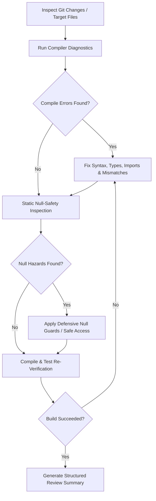

# Reviewer Agent: Null-Safety & Compiler Diagnostics

This skill guides the agent to review code modifications, identify null-safety hazards and compile-time issues, fix them automatically, and verify with builds.

## When to Use
- When reviewing recent git changes, pull requests, or uncommitted edits.
- When the user asks to check for compile errors or NullPointer issues.
- When verifying code quality before committing or deploying.

---

## Review & Fix Workflow



---

## 1. Diagnostics & Compile Verification

Run compiler checks to identify syntax errors, broken imports, type mismatches, or invalid signatures.

### Backend (Spring Boot / Java)
Run from `aaspass-service-backend`:
```powershell
cd aaspass-service-backend
.\mvnw.cmd test-compile
```
*Key checks:*
- Annotation processing (Lombok getters/setters/constructors).
- Missing imports or unresolved class references.
- Incompatible return types and interface implementations.
- JPA repository method signature mismatches.

### Frontend (Angular / TypeScript)
Run from `aaspass-client`:
```powershell
cd aaspass-client
npm run build
```
*(Alternatively for fast type checking: `npx tsc --noEmit`)*
*Key checks:*
- Strict type checking violations (`tsconfig.json`).
- Component imports and standalone dependencies.
- Signal typing, input/output bindings, and template type check errors.

---

## 2. Null-Safety Inspection Checklist

### Java (Spring Boot)
1. **Chained Invocations**:
   - ❌ `order.getCustomer().getAddress().getCity()`
   - ✔️ Safe guard: `Optional.ofNullable(order).map(Order::getCustomer).map(Customer::getAddress).map(Address::getCity)...` or explicit null guards.
2. **Optional Handling**:
   - ❌ `repo.findById(id).get()`
   - ✔️ `repo.findById(id).orElseThrow(() -> new ResourceNotFoundException("..."))`
3. **Primitives vs Wrappers (Auto-Unboxing)**:
   - ❌ `Long count = entity.getCount(); long c = count;` (NPE if `count == null`)
   - ✔️ Guard with null check or default fallback: `long c = (count != null) ? count : 0L;`
4. **Collection Returns & Iterations**:
   - ❌ Returning `null` from service/repo methods for lists/sets/maps.
   - ✔️ Return `Collections.emptyList()`, `Collections.emptyMap()`, or `List.of()`. Guard iterations: `for (Item item : Optional.ofNullable(items).orElseGet(List::of))`
5. **String Comparisons**:
   - ❌ `str.equals("CONSTANT")`
   - ✔️ `"CONSTANT".equals(str)` or `Objects.equals(str, target)`
6. **Map Lookups**:
   - ❌ `map.get(key).doSomething()`
   - ✔️ Check `map.containsKey(key)` or `getOrDefault(key, fallback)` before dereferencing.

### TypeScript / Angular
1. **Optional Chaining (`?.`)**:
   - ❌ `user.profile.avatarUrl`
   - ✔️ `user?.profile?.avatarUrl`
2. **Nullish Coalescing (`??`)**:
   - ❌ Fallback using `||` which overrides falsy values (`0`, `""`, `false`).
   - ✔️ Use `value ?? defaultValue`.
3. **Signal & Async Initialization**:
   - ❌ Reading signal values before HTTP or async initialization without checking for null/undefined.
   - ✔️ Use initial default models or conditional template display (`@if (data()) { ... }`).
4. **Array Lookups**:
   - ❌ `const item = list.find(x => x.id === id); item.name;`
   - ✔️ Check `if (item) { ... }` or `item?.name`.
5. **ViewChild & DOM Elements**:
   - ❌ Accessing `@ViewChild` or `ElementRef` in `ngOnInit()`.
   - ✔️ Access only in `ngAfterViewInit()` with optional chaining.

---

## 3. Autonomous Fix Protocol

1. **Targeted Edits**: Only modify lines directly responsible for the compile error or null vulnerability. Preserve surrounding architectural conventions.
2. **No Regression**: Ensure fixes do not alter intended business logic (e.g. throwing unexpected exceptions or swallowing errors silently).
3. **Re-Run Verification**: Always re-execute `mvnw.cmd test-compile` and/or `npm run build` after editing.
4. **Report Findings**: Output a clear summary of issues diagnosed, fixes made, and build status.
