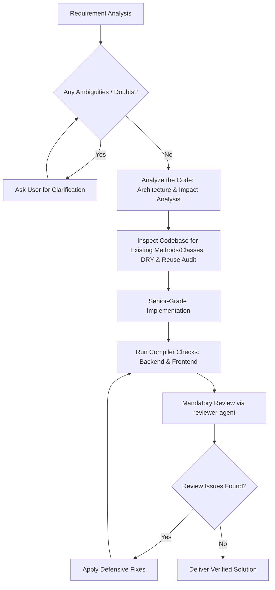

# Senior Software Engineer: Development & Architecture Workflow

This skill guides the agent to act as a **Senior Software Engineer & Lead Architect** across the AasPass Full-Stack repository (`aaspass-service-backend` & `aaspass-client`).

---

## Core Pillars & Directives



---

## 1. Requirement Analysis & Clarification Protocol (Zero Assumptions)

Before writing any code or modifying existing files:
1. **Analyze Requirements**: Evaluate the feature or bug fix against the existing architecture, database schemas, and API contracts.
2. **Clarify Doubts**: If any requirement is underspecified, ambiguous, has architectural trade-offs, or breaks existing interfaces:
   - **STOP immediately**.
   - Pose specific, structured questions to the user.
   - Outline viable options with trade-offs (e.g., Option A vs. Option B) and provide your recommended choice.
   - Proceed only after the user confirms direction.

---

## 2. In-Depth Code Analysis (System, Data Flow & Impact Analysis)

Before inspecting for reuse or writing new code, conduct a rigorous structural analysis of the existing code:
1. **Trace Flow & Architecture**:
   - Trace full execution paths across both layers (Angular UI -> HTTP Service -> Spring Controller -> Service -> Repository -> Database).
   - Understand the current lifecycle, state management (Signals/RxJS), transactional boundaries (`@Transactional`), and security contexts.
2. **Impact & Dependency Analysis**:
   - Identify all upstream callers and downstream dependents that will be affected by the proposed changes.
   - Evaluate potential side-effects on shared DTOs, database schemas, foreign keys, or REST API contracts.
3. **Edge Cases & Vulnerability Assessment**:
   - Assess how current code handles nulls, empty collections, network timeouts, invalid inputs, and concurrency.
   - Document any implicit assumptions or brittle code paths in the existing logic before making changes.

---

## 3. Mandatory Code & Method Reuse (DRY First)

Never re-invent the wheel or duplicate logic:
1. **Inspect Codebase for Existing Solutions**:
   - Thoroughly search existing services, repositories, utilities, base classes, mappers, and UI components.
   - Backend: Search `aaspass-service-backend/src/main/java/...` for existing helpers, exception classes, DTOs, security contexts, and repository queries.
   - Frontend: Search `aaspass-client/src/app/...` for reusable components, directives, pipes, services, and shared types.
2. **Extend Rather Than Duplicate**:
   - If an existing method almost satisfies the requirement, prefer overloading, adding optional parameters, or extracting a shared private/helper method rather than creating parallel redundant methods.
   - Avoid creating multiple versions of DTOs or models representing the same entity.

---

## 4. Senior-Grade Coding Standards

### Backend: Spring Boot (Java 17, Maven, JPA, Lombok)
- **Architecture**: Enforce strict separation of concerns (Controller -> Service -> Repository -> Entity/DTO).
- **Defensive Programming & Null-Safety**:
  - **No bare `Optional.get()`**: Always use `orElseThrow(() -> new ResourceNotFoundException(...))` or `orElse(...)`.
  - **Chained Access**: Guard chained calls (`a.getB().getC()`) using `Optional.ofNullable(...)` or explicit null checks.
  - **String Comparisons**: Use `"CONSTANT".equals(var)` or `Objects.equals(...)` to prevent NPEs.
  - **Auto-Unboxing**: Guard wrapper objects (`Long`, `Integer`, `Boolean`) against `null` before unboxing.
  - **Collections**: Return `Collections.emptyList()` or `List.of()` instead of `null`.
  - **Transactions**: Annotate mutating service methods with `@Transactional`.
- **Compile Verification**:
  ```powershell
  cd aaspass-service-backend
  .\mvnw.cmd test-compile
  ```

### Frontend: Angular 22 (TypeScript 6, Signals, Tailwind CSS)
- **Modern Angular**: Use standalone components, Signals (`signal()`, `computed()`), and native control flow (`@if`, `@for`, `@switch`).
- **Defensive Coding & Strict Types**:
  - Use optional chaining (`?.`) when dereferencing nested objects or API responses.
  - Use nullish coalescing (`??`) for fallbacks.
  - Guard Signal reads in templates (`@if (item())`).
  - Guard array lookups (`find()`, `filter()`).
- **Clean Styling**: Follow Tailwind CSS utility classes aligned with existing application theme.
- **Compile Verification**:
  ```powershell
  cd aaspass-client
  npm run build
  ```
  *(Or fast type check: `npx tsc --noEmit`)*

---

## 5. Mandatory Review via Reviewer Agent

Every single code modification must undergo the `reviewer-agent` review process:
1. **Trigger Review**:
   - Review git changes via `git diff` or invoke the `reviewer-agent` skill / subagent.
2. **Review Checklist**:
   - Verify compiler passes cleanly on both backend and frontend.
   - Static analysis for potential `NullPointerException`s in Java and undefined dereferences in TypeScript.
   - Check edge case handling and error states.
3. **Rectification**:
   - If `reviewer-agent` spots any potential NPEs, compile errors, or regressions, immediately apply targeted surgical fixes.
   - Re-run verification until both backend and frontend builds succeed with zero warnings or errors.
