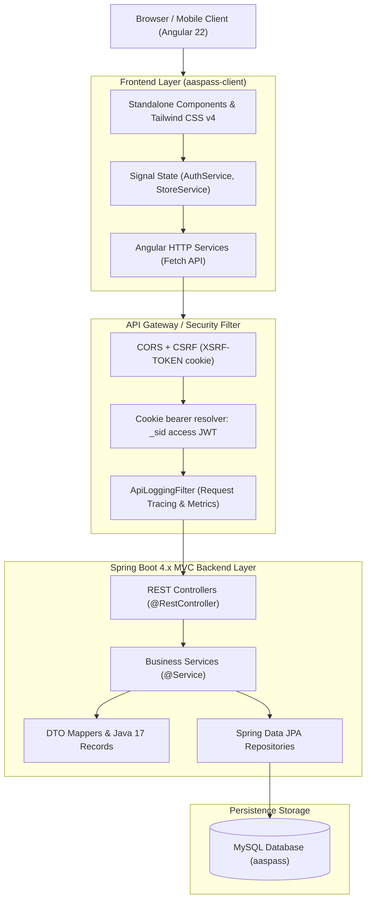
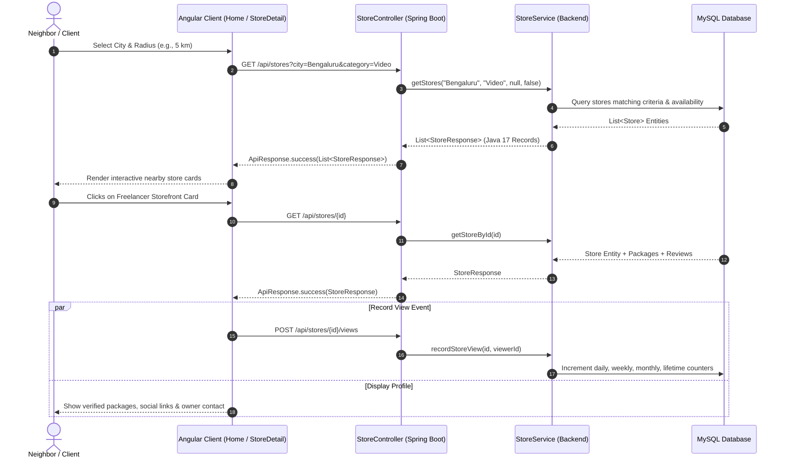
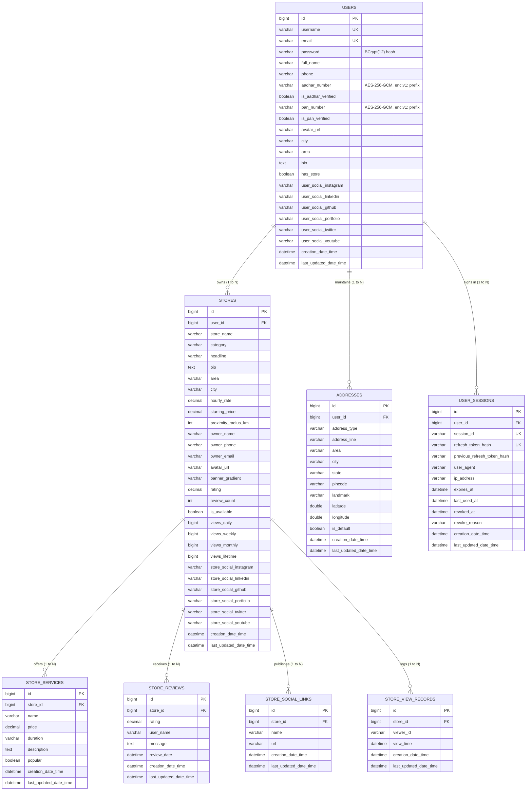

# AasPass (आस-पास) — Hyperlocal Freelancing & Skill Storefront Platform
## Comprehensive Master Project Specification & Architecture Dossier

> **Platform Version:** 1.0.0-PROD-READY  
> **Repository:** `AasPass-Freelancing`  
> **Primary Documentation:** `doc/PROJECT_DETAILS.md`  
> **Change Tracking Log:** `doc/AI-doc/CHANGELOG.md`  
> **Last Updated:** October 2026  

---

## 📑 Table of Contents

1. [Executive Summary & Product Vision](#1-executive-summary--product-vision)
2. [Market Opportunity & Competitive Differentiation](#2-market-opportunity--competitive-differentiation)
3. [Core Architectural Philosophy: Unified Account Model](#3-core-architectural-philosophy-unified-account-model)
4. [End-to-End Technology Stack](#4-end-to-end-technology-stack)
5. [System Architecture & Data Flow Diagrams](#5-system-architecture--data-flow-diagrams)
6. [Data Model & Database Schema (Spring Data JPA)](#6-data-model--database-schema-spring-data-jpa)
7. [Comprehensive REST API Specification](#7-comprehensive-rest-api-specification)
8. [Frontend Component Architecture & Reactive Signals](#8-frontend-component-architecture--reactive-signals)
9. [Detailed Feature Breakdown & User Journeys](#9-detailed-feature-breakdown--user-journeys)
10. [Engineering Standards, Null-Safety & Defect Prevention](#10-engineering-standards-null-safety--defect-prevention)
11. [Testing Infrastructure & Quality Assurance](#11-testing-infrastructure--quality-assurance)
12. [Local Environment Setup & Execution Guide](#12-local-environment-setup--execution-guide)
13. [Project Directory Layout](#13-project-directory-layout)
14. [Development Roadmap & Future Milestones](#14-development-roadmap--future-milestones)

---

## 1. Executive Summary & Product Vision

**AasPass (आस-पास)** is a neighborhood-first, hyperlocal freelancing and skill marketplace engineered to bridge the divide between local talent (college students, creative professionals, technical freelancers, and neighborhood side-hustlers) and local clients seeking fast, trusted, in-person or nearby service fulfillment within a **2 km to 10 km radius**.

### The Core Problem Statement
Local service demand is massive but fragmented:
* **The Freelancer Dilemma:** Millions of capable students and skilled creators cannot win gigs on global platforms because those systems demand hundreds of historical reviews, take hefty 20% platform fees, and force them to compete with low-cost labor across the globe.
* **The Commercial Storefront Barrier:** Freelancers cannot register their home on Google Maps or local business directories without sacrificing their residential privacy or facing commercial zoning hurdles.
* **The WhatsApp Society Trap:** Local gig requests are buried inside chaotic apartment WhatsApp groups, society bulletin boards, and unorganized Telegram chats with zero accountability, no portfolios, and no verified reputation.

### The AasPass Solution
AasPass introduces **Digital Skill Storefronts for Neighbors**:
* **Physical Proximity & Organic Trust:** Connect with freelancers 1 to 5 km away whom you can meet at a neighborhood coffee shop, collaborate with face-to-face, or have on-site within 30 minutes.
* **Residential Privacy Protection:** Displays neighborhood localities (e.g., *Indiranagar, Bengaluru*) and service radii without publishing sensitive private apartment or flat numbers.
* **Neighborhood Turnaround Speeds:** Instant turnarounds for high-demand digital and physical gigs: Instagram Reels editing, college mentorship, portfolio websites, event photography, PC building, and hardware setups.
* **Zero Barrier to Entry:** Any neighbor can launch a branded digital storefront in under two minutes with zero upfront listing costs.

---

## 2. Market Opportunity & Competitive Differentiation

| Vector | Global Freelance Sites (Upwork, Fiverr) | Home Repair Portals (Urban Company) | Google Maps / Justdial | AasPass (आस-पास) |
| :--- | :--- | :--- | :--- | :--- |
| **Primary Focus** | Global, cross-border remote digital work | Standardized home repair (plumbing, AC, cleaning) | Brick-and-mortar commercial retail stores | **Hyperlocal creative, tech & professional skills** |
| **Proximity Radius** | Global (thousands of kilometers) | City-wide algorithmic dispatch | Commercial premises only | **2 km, 5 km, 10 km neighborhood radius** |
| **Collaboration Mode** | Strictly remote (asynchronous screen chats) | In-person manual technician visit | Walk-in shop visitation | **Hybrid: Meet at local cafes or collaborate in person** |
| **Listing Requirement** | Global portfolio, high review count | Agency contractor onboarding | Commercial address verification | **Digital Skill Storefront with neighborhood tags** |
| **Platform Commission** | Steep 10% – 20% cut on every dollar | 25% – 35% commission on service value | Cost-per-click ad spending | **Neighborhood-first, low-friction community model** |
| **Newcomer Friendly** | Harsh algorithm, virtually zero discovery for beginners | Contractor quotas and manual approvals | High ad budget required | **Proximity-based discovery gives local newcomers equal footing** |

---

## 3. Core Architectural Philosophy: Unified Account Model

AasPass is built upon the **Unified Account Model (Option A)**, mirroring the modern paradigm established by Airbnb, OLX, and GitHub:

```
                            ┌───────────────────────────────────────────────┐
                            │            Unified Account Identity           │
                            │      (Single Login: Username/Email + Pass)    │
                            └───────────────────────┬───────────────────────┘
                                                    │
                      ┌─────────────────────────────┴─────────────────────────────┐
                      ▼                                                           ▼
       ┌─────────────────────────────┐                             ┌─────────────────────────────┐
       │         Client Role         │                             │       Freelancer Role       │
       ├─────────────────────────────┤                             ├─────────────────────────────┤
       │ • Discover nearby gigs      │                             │ • Open Branded Storefront   │
       │ • Filter by 2/5/10 km       │                             │ • Multi-Store Management    │
       │ • Submit reviews & ratings  │                             │ • Set Package Rates (₹)     │
       │ • Manage saved addresses    │                             │ • View Real-Time Analytics  │
       └─────────────────────────────┘                             └─────────────────────────────┘
```

### Key Principles of the Unified Architecture:
1. **No Split Account Silos:** Users do not register separately as a "Client" or a "Freelancer". Every account is immediately capable of hiring local talent.
2. **On-Demand Store Activation:** Any user can click **"List Your Services / Open Store"** at any moment to launch a storefront.
3. **Multi-Store Management Under a Single Identity:**
   * A single user can operate multiple specialized storefronts (e.g., one store for *Web Development* and a second store for *Drone Videography*).
   * Each store maintains independent branding, pricing packages, customer reviews, view metrics, and social media handles.
   * Switching between stores is instantaneous via the user profile and navbar switcher.

---

## 4. End-to-End Technology Stack

### Backend Stack (`aaspass-service-backend`)
* **Runtime & Framework:** Java 17 LTS, Spring Boot 4.0.8
* **Persistence & ORM:** Spring Data JPA, Hibernate ORM
* **Database Engine:** MySQL 8.0+ (Production & Local Development), H2 In-Memory (Test support)
* **API Architecture:** RESTful MVC pattern with standardized JSON envelope (`ApiResponse<T>`)
* **Data Transfer Contracts:** Java 17 `record`s with Lombok `@Builder` and compact defensive constructors
* **Input Validation:** Jakarta Bean Validation (`@NotBlank`, `@Size`, `@DecimalMin`, `@DecimalMax`, `@Email`)
* **Security:** Spring Security (stateless, `oauth2-resource-server` JWT), HttpOnly cookie sessions, CSRF via `XSRF-TOKEN`/`X-XSRF-TOKEN`, BCrypt(12) password hashing, AES-256-GCM encrypted KYC fields
* **Logging & Observability:** Custom `ApiLoggingFilter` (`OncePerRequestFilter`) with SLF4J / Logback tracing request ID, duration, client IP, and HTTP status codes
* **Build System:** Apache Maven (`mvnw` wrapper)

### Frontend Stack (`aaspass-client`)
* **Runtime & Framework:** Angular 22 (Modern Standalone Component Architecture, zoneless-ready)
* **Language:** TypeScript 6.0 with strict type checking
* **State Management:** Fine-grained Angular Signals (`signal`, `computed`, `effect`, `toSignal`)
* **Styling Framework:** Tailwind CSS v4 with PostCSS plugins
* **HTTP Client:** Angular `provideHttpClient(withFetch())` with credentialed requests, XSRF handling and a dev proxy (`npm start` forwards `/api` to `:8080`)
* **Routing & Guards:** Angular Router with functional `authGuard` providing contextual login interception
* **Avatar Generation:** Integrated Dicebear Avataaars SVG engine for automated fallback avatar generation
* **Build & Dev Server:** Vite build engine with Hot Module Replacement (HMR)
* **Notifications:** Shared `ToastService` + `Toaster` component for API errors and confirmations
* **Unit Testing:** Vitest with JSDOM environment

---

## 5. System Architecture & Data Flow Diagrams

### High-Level System Architecture



### Proximity Discovery & Store Interaction Sequence



---

## 6. Data Model & Database Schema (Spring Data JPA)

### Entity-Relationship (ER) Diagram



### Sensitive Data & Sessions
* **`users.password`** holds a BCrypt (cost 12) hash (`$2...`); a startup migration (`SecurityDataMigration`) converts legacy plaintext values.
* **`users.aadhar_number` / `users.pan_number`** are encrypted by a JPA attribute converter (AES-256-GCM, `enc:v1:` prefix). API responses return only masked values (`XXXXXXXX1234`, `XXXXXX234F`).
* **`user_sessions`** stores one row per login: only SHA-256 hashes of the current and previous refresh tokens (for reuse detection), the absolute `expires_at` (30 days), `last_used_at`, and `revoked_at` / `revoke_reason`. A revoked or logged-out session can never be rejoined.

### Database Superclass Architecture
All persistence models strictly extend a two-tier mapped superclass hierarchy to eliminate boilerplate and enforce immutability:
1. **`BaseIdEntity` (`@MappedSuperclass`)**:
   * Encapsulates `@Id @GeneratedValue(strategy = GenerationType.IDENTITY) private Long id`.
   * Enforces **read-only ID semantics**: Exposes `getId()` with **strictly NO setter**, preventing ID corruption across ORM lifecycles.
2. **`BaseAuditEntity` (`@MappedSuperclass extends BaseIdEntity`)**:
   * Encapsulates `creationDateTime` and `lastUpdatedDateTime`.
   * Utilizes JPA lifecycle hooks (`@PrePersist`, `@PreUpdate`) to maintain automated, tamper-proof timestamps.

---

## 7. Comprehensive REST API Specification

### Unified Response Format (`ApiResponse<T>`)
Every API endpoint responds with a standardized JSON wrapper:
```json
{
  "success": true,
  "message": "Operation completed successfully",
  "data": { ... },
  "errors": [],
  "timestamp": "2026-10-24T20:30:00.000Z"
}
```

### Access Control Summary
* **Public:** `POST /api/auth/login|register|refresh|logout`, every `GET /api/stores/**` (catalog, services, reviews), `POST /api/stores/{id}/views`, and `GET /api/users/{id}` (public profile, KYC masked).
* **Authenticated (valid `_sid` cookie, plus `X-XSRF-TOKEN` on writes):** everything else, including `GET /api/auth/me`, all address endpoints and every store, service, review and profile write.
* **Owner-only writes:** a caller may only modify their own profile/KYC/addresses and their own stores and service packages; foreign resources return `403`. Unauthenticated calls return `401`.
* Tokens travel only in HttpOnly cookies: `_sid` (access JWT, 15 min, SameSite=Lax, Path `/api`) and `_rid` (refresh, 30-day absolute session, SameSite=Strict, Path `/api/auth`). `Secure` is automatic except on localhost/127.0.0.1/::1.

### 1. Authentication & Session Endpoints (`/api/auth`)

| Method | Endpoint | Access | Description | Request Body | Response Data |
| :--- | :--- | :--- | :--- | :--- | :--- |
| `POST` | `/api/auth/login` | Public | Authenticate via username or email; sets `_sid` and `_rid` cookies | `LoginRequest` (usernameOrEmail, password) | `AuthResponse` (`UserResponse`) |
| `POST` | `/api/auth/register` | Public | Register a new unified account and sign it in | `RegisterRequest` (username, email, password, fullName, phone, city, area, avatarUrl) | `AuthResponse` (`UserResponse`) |
| `POST` | `/api/auth/refresh` | Public (needs `_rid` cookie) | Rotate the refresh token and issue a new access token; reuse of a rotated token revokes the session | None (cookie) | `AuthResponse` (`UserResponse`) |
| `GET` | `/api/auth/me` | Authenticated | Fetch the current user from the access cookie (no `userId` parameter) | None | `UserResponse` |
| `POST` | `/api/auth/logout` | Public | Revoke the session and clear the auth cookies | None | `null` |

### 2. Storefront Catalog & Discovery Endpoints (`/api/stores`)

> `GET` endpoints and `POST /{id}/views` are public. `POST /api/stores` requires authentication; `PUT`, `DELETE` and `PATCH` are owner-only.

| Method | Endpoint | Description | Query Parameters / Payload | Response Data |
| :--- | :--- | :--- | :--- | :--- |
| `GET` | `/api/stores` | Discover nearby stores with multi-criteria filters | `city`, `category`, `query`, `availableOnly` | `List<StoreResponse>` |
| `GET` | `/api/stores/{id}` | Retrieve comprehensive storefront details | Path variable `id` | `StoreResponse` |
| `GET` | `/api/stores/user/{userId}` | List all storefronts owned by specific user | Path variable `userId` | `List<StoreResponse>` |
| `POST` | `/api/stores` | Publish a new digital skill storefront | `StoreCreateRequest` | `StoreResponse` (201 Created) |
| `PUT` | `/api/stores/{id}` | Update existing storefront details | `StoreUpdateRequest` | `StoreResponse` |
| `DELETE` | `/api/stores/{id}` | Remove a storefront | Path variable `id` | `null` (200 OK) |
| `PATCH` | `/api/stores/{id}/toggle-status` | Toggle availability ("Open for Gigs" vs "Paused") | Path variable `id` | `StoreResponse` |
| `POST` | `/api/stores/{id}/views` | Record store visit & increment engagement analytics | `?viewerId={optionalId}` | `StoreResponse` |

### 3. Store Service Packages Endpoints (`/api/stores/{storeId}/services`)

> `GET` is public; `POST`, `PUT` and `DELETE` are owner-only (store owner).

| Method | Endpoint | Description | Request Body | Response Data |
| :--- | :--- | :--- | :--- | :--- |
| `GET` | `/api/stores/{storeId}/services` | List all service packages offered by a store | None | `List<ServiceItemResponse>` |
| `POST` | `/api/stores/{storeId}/services` | Add a new package to a store | `ServiceItemRequest` (name, price, duration, description, popular) | `ServiceItemResponse` (201 Created) |
| `PUT` | `/api/stores/{storeId}/services/{serviceId}` | Update an existing service package | `ServiceItemRequest` | `ServiceItemResponse` |
| `DELETE` | `/api/stores/{storeId}/services/{serviceId}` | Delete a service package | None | `null` |

### 4. Ratings & Client Reviews Endpoints (`/api/stores/{storeId}/reviews`)

> `GET` is public; `POST` requires authentication (reviewer identity comes from the session).

| Method | Endpoint | Description | Constraints & Details | Response Data |
| :--- | :--- | :--- | :--- | :--- |
| `GET` | `/api/stores/{storeId}/reviews` | Fetch verified client reviews for a store | Ordered by date descending | `List<StoreReviewResponse>` |
| `POST` | `/api/stores/{storeId}/reviews` | Submit client rating and feedback | `rating` bounded strictly between 1.0 and 5.0 | `StoreReviewResponse` (201 Created) |

### 5. User Profile & Multi-Address Endpoints (`/api/users`)

> All address endpoints are authenticated and owner-only.

| Method | Endpoint | Description | Request Body | Response Data |
| :--- | :--- | :--- | :--- | :--- |
| `GET` | `/api/users/{id}` | Public. Fetch user profile, masked KYC and stores | None | `UserResponse` |
| `PUT` | `/api/users/{id}` | Owner-only. Update personal details, bio and avatar | `UserUpdateRequest` | `UserResponse` |
| `PUT` | `/api/users/me/kyc` | Authenticated. Set the caller's Aadhaar/PAN; encrypted at rest, returned masked | `KycUpdateRequest` (aadharNumber, panNumber) | `UserResponse` |
| `GET` | `/api/users/{userId}/addresses` | List all saved addresses for a user | None | `List<AddressResponse>` |
| `POST` | `/api/users/{userId}/addresses` | Add a new address to user address book | `AddressRequest` | `AddressResponse` (201 Created) |
| `PUT` | `/api/users/{userId}/addresses/{addressId}` | Modify an existing address | `AddressRequest` | `AddressResponse` |
| `DELETE` | `/api/users/{userId}/addresses/{addressId}` | Delete an address | None | `null` |
| `PATCH` | `/api/users/{userId}/addresses/{addressId}/default` | Set an address as primary default | None | `AddressResponse` |

---

## 8. Frontend Component Architecture & Reactive Signals

The client is built using Angular 22 standalone components and fine-grained reactive signals:

```
aaspass-client/src/app/
├── components/
│   ├── navbar/                  # Global navigation, city selector, search input, multi-store switcher
│   ├── toaster/                 # Global toast host for API errors and confirmations
│   └── social-media-links/      # Reusable multi-channel social manager with preset chips & validation
├── pages/
│   ├── home/                    # Discovery hub with radius filters, category carousels & store cards
│   ├── store-detail/            # Public storefront with packages, reviews, owner contact & analytics
│   ├── create-store/            # 2-column store creator/editor with real-time live preview card
│   ├── profile/                 # Profile management hub: Personal info, KYC, Addresses & Multi-Store manager
│   └── auth/                    # Dedicated standalone /login and /signup pages
├── services/
│   ├── auth/                    # AuthService & AuthHttpService (cookie session restore, silent refresh)
│   ├── store/                   # StoreService & StoreHttpService (Reactive catalog, multi-store & analytics)
│   └── toast/                   # ToastService (shared notifications)
├── guards/
│   └── auth.guard.ts            # Route protection: redirects unauthenticated users to login
└── models/                      # Strict TypeScript interfaces matching backend Java records
```

### Signal-Driven State Management

```typescript
// Example: Reactive Multi-Store Derivation in StoreService
readonly stores = signal<StoreProfile[]>([]);
readonly currentUser = signal<UserProfile>(EMPTY_USER_PROFILE);

// Automatically derives owned stores for the active session
readonly userStores = computed(() => {
  const currentUserId = this.currentUser().id;
  const fromMaster = this.stores().filter(s => s.userId === currentUserId);
  if (fromMaster.length > 0) return fromMaster;
  return this.currentUser().stores || [];
});

// Real-time Discovery Filter Computation
readonly filteredStores = computed(() => {
  const query = this.searchQuery().toLowerCase().trim();
  const cat = this.selectedCategory();
  const city = this.selectedCity();
  const maxDist = this.selectedMaxDistanceKm();

  return this.stores().filter(store => {
    const matchesCity = !city || store.city === city;
    const matchesCat = cat === 'All' || store.category === cat;
    const matchesDist = store.distanceKm <= maxDist;
    const matchesQuery = !query || 
      store.storeName.toLowerCase().includes(query) ||
      store.skills.some(sk => sk.toLowerCase().includes(query));
    return matchesCity && matchesCat && matchesDist && matchesQuery;
  });
});
```

---

## 9. Detailed Feature Breakdown & User Journeys

### 1. Proximity-Based Discovery & Search
* **Radius Filtering:** Interactive radius buttons allow users to toggle talent within **2 km**, **5 km**, **10 km**, or across the **Entire City**.
* **City Selector:** Switch seamlessly between active major hubs (**Bengaluru, Delhi NCR, Mumbai, Pune, Hyderabad**).
* **Category Filtering:**
  * 🎬 Video & Short Reels Editing
  * 💻 Web, App & Tech Development
  * 📷 Event & Product Photography
  * 📚 Tutoring & Mentorship
  * 🎨 Graphics, Logos & Brand Design
  * 🛠️ Tech Support, PC Builds & Hardware Setup
* **Real-Time Search:** Live instant search across store titles, freelancer bios, and individual skill tags.

### 2. Digital Skill Storefronts & Packages
* **Transparent Service Packages:** Fixed-price packages with delivery turnaround times (e.g., *“30-sec Instagram Reel — ₹450 / 24 hrs”*).
* **Verified Social Media Integration:** Displays platform-specific badge chips (Instagram, LinkedIn, GitHub, YouTube, Portfolio, Twitter/X, Behance, Dribbble) that sanitize URLs and redirect directly to verified external profiles.
* **Dual Social Media Architecture:**
  * **Store Social Links:** Dedicated business channels for the storefront.
  * **Owner Personal Social Links:** Direct channel to contact the freelancer on personal platforms.

### 3. Store Creation with Real-Time Live Preview
* **Side-by-Side Builder:** Two-column layout where form adjustments immediately update an interactive mock store card in real time before publishing.
* **Smart Avatar Integration:** Automatically assigns deterministic or random avatars via Dicebear Avataaars SVG generator if no custom photo URL is provided.
* **Custom Service Package Builder:** Add and configure unlimited service packages with prices and durations.

### 4. Comprehensive User Profile & Verification (KYC)
* **Government Identity Verification (KYC):**
  * **Aadhaar Card:** 12-digit identity entry, encrypted at rest (AES-256-GCM), displayed masked (`XXXXXXXX1234`) with verified trust badges.
  * **PAN Card:** 10-character alphanumeric tax identifier, encrypted at rest and displayed masked (`XXXXXX234F`).
  * Edited through `PUT /api/users/me/kyc`.
* **Multi-Address Book:** Manage multiple locations (Home, Office, Studio) with geo-coordinates and primary default toggling.
* **Multi-Store Management Dashboard:**
  * Tabbed switcher displaying all stores owned by the account.
  * Quick status toggle: **"Open for Gigs"** (instant discovery) vs. **"Paused"** (temporarily hidden).
  * Direct action shortcuts to Edit Store, View Live Storefront, or Delete Store.

### 5. Verified Client Reviews & Ratings
* **Strict Rating Scale [1.0 to 5.0]:** Enforces mathematical bounds on all submitted reviews.
* **Anti-Self-Rating Shield:** Freelancers cannot review their own storefronts.
* **Dynamic Recalculation:** Every review instantly updates the store's average rating and total review count.

### 6. Store Engagement & View Analytics
* **Granular Timeframe Breakdown:** Store owners can audit storefront discovery across **Daily (24h)**, **Weekly (7d)**, **Monthly (30d)**, and **Lifetime** views.
* **Automated View Logging:** Visiting a storefront records view events asynchronously without interrupting the user experience.

---

## 10. Engineering Standards, Null-Safety & Defect Prevention

In accordance with repository guidelines (`AGENTS.md`), the codebase adheres to strict senior-level engineering practices:

### Null-Safety Standards in Java (Spring Boot)
1. **Guarded Chained Getters:** No deep dereferencing without null validation.
2. **Optional Handling:** Use `Optional.orElseThrow()` or `Optional.orElse()` rather than unprotected `.get()`.
3. **Literal-First String Equality:** `"VALUE".equals(variable)` to avoid `NullPointerException`.
4. **Safe Unboxing:** Wrapper types (`Long`, `Integer`, `Double`, `Boolean`) are null-checked prior to primitive arithmetic.
5. **Defensive Collections:** Methods return `Collections.emptyList()` or `List.of()` rather than returning `null`.
6. **Immutable Java 17 Records:** All DTOs use compact constructors to enforce non-null fallback lists (`List.of()`).

### Null-Safety Standards in TypeScript / Angular
1. **Optional Chaining (`?.`):** Safe property access across all deeply nested API objects.
2. **Nullish Coalescing (`??`):** Reliable fallback defaults for numbers, strings, and booleans.
3. **Native Control Flow Protection:** Template reads are guarded by `@if (item())` prior to member access.
4. **Array Lookup Guarding:** Results of `.find()` or `.filter()` are checked before referencing properties.

---

## 11. Testing Infrastructure & Quality Assurance

### Backend Test Suite (Spring Boot)
* **Framework:** JUnit 5, MockMvc, Spring Data JPA Test
* **Isolation:** Test methods are annotated with `@Transactional` ensuring zero database pollution across test runs.
* **Coverage:**
  * `AuthControllerTest`: Verifies login success, bad credentials, user registration, duplicate detection, and session retrieval.
  * `StoreAndUserControllerTest`: Verifies store creation, distance filtering, availability toggles, review rating bounds, address management, and Dicebear avatar fallbacks.
  * `security.*` tests: JWT tokens, auth cookies, session rotation/reuse detection, KYC encryption and masking.
  * `EntityDesignTest`: Asserts read-only ID immutability and `@PrePersist`/`@PreUpdate` timestamp accuracy.

### Frontend Test Suite (Angular 22)
* **Framework:** Vitest with JSDOM
* **Coverage:**
  * `auth.service.spec.ts` / `auth-http.service.spec.ts`: Validate login/signup, cookie session restore, silent refresh and session end on rejected refresh.
  * `toast.service.spec.ts`: Validates the shared toaster.
  * `store.service.spec.ts`: Validates API store mapping, multi-store derivation, search filtering, review addition, and engagement analytics.
  * `app.spec.ts`: Validates root application rendering and navigation layout.

---

## 12. Local Environment Setup & Execution Guide

### Prerequisites
* **Java:** JDK 17 or higher
* **Node.js:** v20.x or higher with **npm** (v10+)
* **Database:** MySQL 8.0+ running on port `3306`

---

### Step 1: Database Initialization
Log into MySQL and initialize the database:
```sql
CREATE DATABASE IF NOT EXISTS aaspass CHARACTER SET utf8mb4 COLLATE utf8mb4_unicode_ci;
```

---

### Step 2: Backend Configuration & Startup
Review `aaspass-service-backend/src/main/resources/application.properties`:
```properties
spring.application.name=aaspass-service-backend
spring.datasource.url=jdbc:mysql://localhost:3306/aaspass?useSSL=false&serverTimezone=UTC
spring.datasource.username=root
spring.datasource.password=root
spring.datasource.driver-class-name=com.mysql.cj.jdbc.Driver
spring.jpa.hibernate.ddl-auto=update
spring.jpa.show-sql=true
spring.profiles.default=dev
```
Secrets are read from `AASPASS_JWT_SECRET` (base64, at least 32 bytes) and `AASPASS_KYC_KEY` (base64, exactly 32 bytes). The default `dev` profile (`application-dev.properties`) supplies **DEV ONLY** fallback keys. In production set `SPRING_PROFILES_ACTIVE` to something other than `dev`, provide both variables (generate with `openssl rand -base64 48` / `openssl rand -base64 32`) and optionally `AASPASS_COOKIE_DOMAIN`. Environment variables override the dev keys.

Compile and start the Spring Boot service:
```powershell
cd aaspass-service-backend
.\mvnw.cmd clean test-compile
.\mvnw.cmd spring-boot:run
```
> The backend server starts at **`http://localhost:8080`**.  
> `DataInitializer` will automatically seed default accounts on first startup if the database is empty. On startup, `SecurityDataMigration` hashes any legacy plaintext passwords and encrypts plaintext KYC values in the existing database.

---

### Step 3: Frontend Startup
In a separate terminal, install dependencies and launch the Vite dev server:
```powershell
cd aaspass-client
npm install
npm start
```
> The client application will be accessible at **`http://localhost:4200`**. `npm start` proxies `/api` to `http://localhost:8080`, so the auth cookies stay same-origin.

---

### Default Demo Credentials

| Username | Email | Password | Role / Account Type |
| :--- | :--- | :--- | :--- |
| `aman` | `aman.sharma@example.com` | `password123` | Regular User / Neighbor (Bengaluru) |
| `priya` | `priya.nair@example.com` | `password123` | Store Owner: PixelCraft Studios (Video Editing) |
| `rohan` | `rohan.gupta@example.com` | `password123` | Store Owner: FullStack Craft (Web & Tech) |

> [!NOTE]
> Passwords are stored as BCrypt hashes; sign in through the regular login form.

---

## 13. Project Directory Layout

```
AasPass-Freelancing/
├── .agents/
│   └── skills/
│       ├── senior-software-engineer/   # Development & architecture workflow instructions
│       └── reviewer-agent/             # Code audit, compile-check & null-safety validation
├── aaspass-client/                     # Angular 22 Frontend Application
│   ├── src/
│   │   ├── app/
│   │   │   ├── components/             # Reusable UI components (Navbar, Toaster, SocialLinks)
│   │   │   ├── config/                 # API base URLs and contract definitions
│   │   │   ├── guards/                 # Functional route protection guards (authGuard)
│   │   │   ├── models/                 # TypeScript interfaces (User, Store, Requests, Responses)
│   │   │   ├── pages/                  # Route views (Home, StoreDetail, CreateStore, Profile, Auth)
│   │   │   ├── services/               # Signal-based domain services (AuthService, StoreService)
│   │   │   ├── app.config.ts           # Angular bootstrap providers & HttpClient configuration
│   │   │   ├── app.routes.ts           # Client route mappings & guard bindings
│   │   │   └── styles.css              # Global styles & Tailwind CSS v4 directives
│   │   └── package.json
│   └── vite.config.ts
├── aaspass-service-backend/            # Spring Boot Java 17 Backend Service
│   ├── src/
│   │   ├── main/
│   │   │   ├── java/com/aaspass/
│   │   │   │   ├── config/             # SecurityConfig (CORS, CSRF, JWT cookies), DataInitializer, API logging filters
│   │   │   │   ├── security/           # Token, auth-cookie, session and KYC crypto services
│   │   │   │   ├── controller/         # REST Controllers (Auth, Store, User, Reviews, Services)
│   │   │   │   ├── dto/                # Java 17 Records (common, request, response)
│   │   │   │   ├── entity/             # JPA Entities & mapped superclasses (BaseId, BaseAudit)
│   │   │   │   ├── exception/          # GlobalExceptionHandler and custom exceptions
│   │   │   │   ├── repository/         # Spring Data JPA Repository interfaces
│   │   │   │   ├── service/            # Business service layer & DtoMapper
│   │   │   │   └── util/               # Helper utilities (AvatarGenerator)
│   │   │   └── resources/
│   │   │       └── application.properties # Spring Boot datasource & JPA settings
│   │   └── test/                       # JUnit 5 & MockMvc integration tests
│   └── pom.xml
├── doc/
│   ├── AI-doc/
│   │   └── CHANGELOG.md                # Timestamped development audit & history log
│   └── PROJECT_DETAILS.md              # Master platform documentation (This file)
├── AGENTS.md                           # Strict repository engineering and coding standards
└── README.md                           # High-level overview and getting started guide
```

---

## 14. Development Roadmap & Future Milestones

### Completed Milestones (v1.0.0)
* [x] **Unified Account Model (Option A):** Single identity for both hiring and offering gigs.
* [x] **Hyperlocal Discovery Engine:** Radius-based proximity filtering (2 km, 5 km, 10 km, Entire City).
* [x] **Store Creation with Live Preview:** Interactive dual-pane builder for fast storefront deployment.
* [x] **Multi-Store Management:** Support for multiple specialized storefronts per single user account.
* [x] **KYC & Identity Verification:** Masked Aadhaar card and PAN card tracking.
* [x] **Store Owner Engagement Analytics:** Daily, weekly, monthly, and lifetime storefront view tracking.
* [x] **Spring Boot REST Persistence:** Complete MVC architecture with MySQL persistence.
* [x] **Java 17 Record Modernization:** Fully immutable DTO layer with Jakarta Bean Validation.
* [x] **Full-Stack Null-Safety:** Comprehensive defect prevention across backend and frontend layers.
* [x] **Cookie-Based JWT Authentication:** HttpOnly access/refresh cookies, rotating refresh tokens with reuse detection, server-side sessions, CSRF protection and owner-only writes.
* [x] **Encrypted KYC & Hashed Passwords:** AES-256-GCM Aadhaar/PAN with masked display, BCrypt(12) passwords.
* [x] **Shared Toaster:** Unified API error and confirmation notifications.

### Upcoming Milestones (v2.0.0)
* [ ] **Spatial Geolocation Queries:** Integration of PostGIS / MySQL GIS spatial indexing (`ST_Distance_Sphere`) for exact coordinate-based neighborhood matching.
* [ ] **SMS OTP Authentication:** Phone OTP login via Twilio / Fast2SMS on top of the existing JWT cookie sessions.
* [ ] **In-App Direct Chat:** WebSocket / STOMP real-time messaging between neighbors.
* [ ] **Neighborhood Escrow Payments:** Milestone-based escrow payments via UPI / Razorpay with release upon gig sign-off.
* [ ] **PWA & Offline Discovery:** Progressive Web App caching for fast neighborhood access on mobile devices.

---

> **AasPass (आस-पास)** — *Connecting Neighborhood Skills, Powering Local Independence.*
